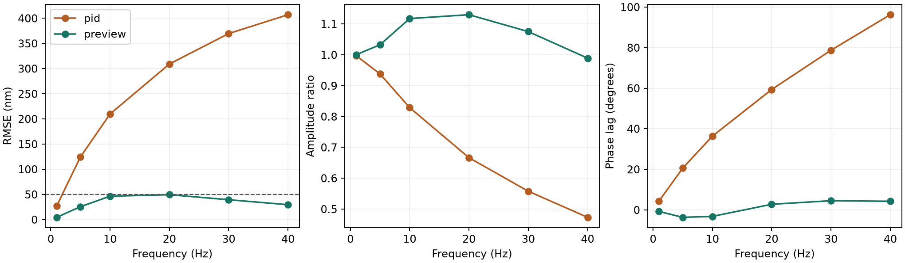
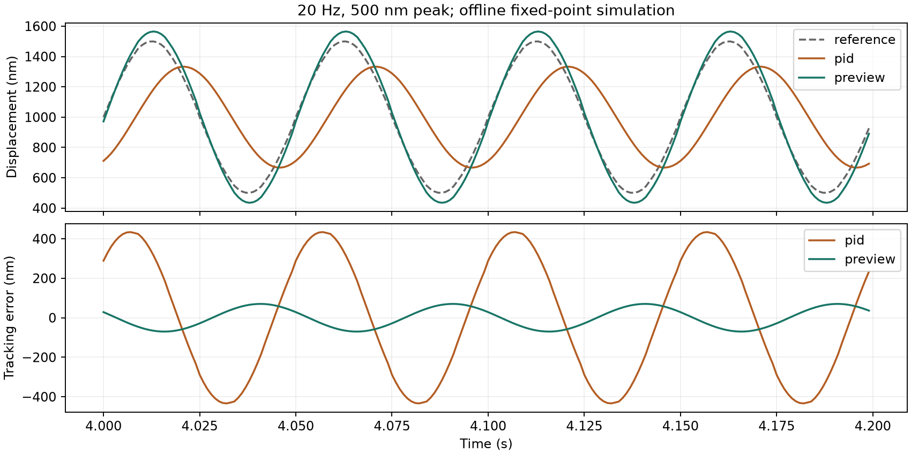

# Moku:Go 迁移：无硬件仿真测试报告

生成时间：2026-10-22T18:42:22.856971+00:00。运行系统：macOS-27.0.1-arm64-arm-64bit-Mach-O。

## 结论与边界

本报告的闭环数据来自本项目的定点数值仿真，不是 Moku 官方演示模式产生的数据。没有连接 Moku:Go、压电或激光干涉仪，没有部署真实 bitstream，也没有验证模拟前端与板上时序。

20 Hz、500 nm 峰值的基准模型中，Preview+ADRC 相对当前 PID 参数的稳态 RMSE 降低 84.0%。是否达到 50 nm 以表中数值为准；这不构成真实硬件指标通过。20 Hz 时 Preview 幅值比约 1.13，存在约 13% 幅值放大；RMSE 只比门限低约 0.47 nm，裕量很小。

Moku 已安装软件与演示模式检查见 [环境调查](../../docs/moku-demo-environment.md)。演示模式的界面可操作性与自定义闭环的运算正确性是两个不同的测试对象。

## 方法

单轴、控制周期 1 ms，板上等效 DDS 使用 256 点正弦查表，轨迹峰值 500 nm、偏置 1000 nm；每次 10 s，去除前 2 s；每条件运行 PID 和 Preview 各 3 次，交替先后顺序。使用和 HDL 相同的 Q16.16 状态量与 Q8.24 系数，全部 1 kHz 数据写入 CSV。

基准对象：K=410 nm/V，tau=8 ms，纯延迟=2 ms，输出 0..5 V，电压变化上限 1000 V/s。PID 参数固定为 Kp=0.002 V/nm、Ki=0.2 V/(nm*s)、Kd=0；观测器 w0=50 rad/s。两算法共用对象、轨迹、采样和输出限制；未进行最优 PID 整定，因此结论仅适用于这些参数。

每个重复实验使用相同的确定性初态，重复标准差为零不代表真实设备有相同重复性。未模拟 ADC 噪声、DAC 12 bit 量化、模拟前端、压电迟滞、信号失锁或 FPGA 资源/时序。相位/幅值以稳态数据对已知频率的正弦、余弦和直流基底做最小二乘拟合；正相位值表示滞后。

## 数值结果

| 条件 | Hz | 控制器 | RMSE nm | 幅值比 | 相位滞后 ° | 饱和比例 |
|---|---:|---|---:|---:|---:|---:|
| baseline-1Hz | 1 | pid | 27.102 | 0.9971 | 4.378 | 0.00% |
| baseline-1Hz | 1 | preview | 4.508 | 1.0007 | -0.729 | 0.00% |
| baseline-5Hz | 5 | pid | 124.484 | 0.9382 | 20.611 | 0.00% |
| baseline-5Hz | 5 | preview | 25.617 | 1.0328 | -3.643 | 0.00% |
| baseline-10Hz | 10 | pid | 209.851 | 0.8290 | 36.373 | 0.00% |
| baseline-10Hz | 10 | preview | 46.514 | 1.1177 | -3.185 | 0.00% |
| baseline-20Hz | 20 | pid | 309.167 | 0.6665 | 59.374 | 0.00% |
| baseline-20Hz | 20 | preview | 49.526 | 1.1302 | 2.791 | 0.00% |
| baseline-30Hz | 30 | pid | 369.703 | 0.5580 | 78.742 | 0.00% |
| baseline-30Hz | 30 | preview | 39.488 | 1.0754 | 4.552 | 0.00% |
| baseline-40Hz | 40 | pid | 407.160 | 0.4733 | 96.255 | 0.00% |
| baseline-40Hz | 40 | preview | 29.624 | 0.9893 | 4.271 | 32.00% |
| gain-minus20-tau-plus50 | 20 | pid | 377.580 | 0.5103 | 83.295 | 0.00% |
| gain-minus20-tau-plus50 | 20 | preview | 176.051 | 0.6607 | 25.926 | 0.00% |
| extra-delay-3ms | 20 | pid | 401.662 | 0.8659 | 74.653 | 0.00% |
| extra-delay-3ms | 20 | preview | 262.118 | 1.3244 | 33.682 | 0.00% |
| zero-delay-diagnostic | 20 | pid | 272.014 | 0.5864 | 50.146 | 0.00% |
| zero-delay-diagnostic | 20 | preview | 0.011 | 1.0000 | -0.000 | 0.00% |





## 如何解释

Preview 的前馈利用对象模型与未来轨迹，减少固定 PID 在较高频率下的幅值衰减和相位滞后。额外延迟与模型失配会改变这种优势；表中的失配试验用于显示敏感性，不能据此保证鲁棒性。当前实现保留原 control.py 的残差观测器定义：模型减测量，补偿为 res1/K。它不是通用 ESO；零延迟诊断与带延迟结果应分别查看。

## 软件与 HDL 验证

本机自动测试：88 passed in 3.61s；进程退出码：0。

自动测试原始输出见 [verification.txt](verification.txt)。界面运行截图见 [qt-simulation.png](qt-simulation.png)。

自动测试覆盖配置损坏、未知关键参数禁止输出、目标版本/散列不匹配、寄存器确认超时、安全归零确认、断连、实验保存、跨线程界面更新和退出。Icarus Verilog 实际运行 FPGA RTL，覆盖 PID/Preview/开环数值、相位回绕、启动禁止、事务提交、信号丢失、算术溢出、时限自动停止与输出斜坡；运行输出单独保存在本目录。

硬件状态轮询不是连续采样，因此不用于正式 RMSE 验收。FPGA 输出 B 提供分帧遥测，但记录仪的采样对齐、符号恢复与量纲还需要实机验证；缺帧不能作为合格记录。

## 复现与产物

```sh
/Users/nccer/Documents/laserai/.venv/bin/python -m laserai.simreport --output reports/moku-simulation-2026-10-23
/Users/nccer/Documents/laserai/.venv/bin/python -m pytest tests test_control.py -q
```

`results.json` 包含环境和所有重复实验；`comparison.csv` 为对比表；`experiments/` 中每次实验包含配置/设备/bitstream 标识快照、全采样率 CSV 和指标 JSON。

## 尚未验证

官方 Go 演示模式的三槽 Phasemeter 画面仅显示 Input A。文档提供双通道与取消 single-input 的通用接口，但这不足以确认三槽下同时有两路独立测相。当前三槽路线仍须验证通道能力；后端显式关闭 single-input，若第二路配置被拒绝则部署失败，不能启用闭环。

macOS 在本机实际运行；Linux/Windows 已配置 CI，但本机不能代替那两个系统的运行结果。真实 Go 三槽部署、Phasemeter 回绕/延迟/失锁、直接驱动电流、bitstream 综合与时序、遥测连续性及 20 Hz/500 nm/50 nm 指标均待实机验证。
