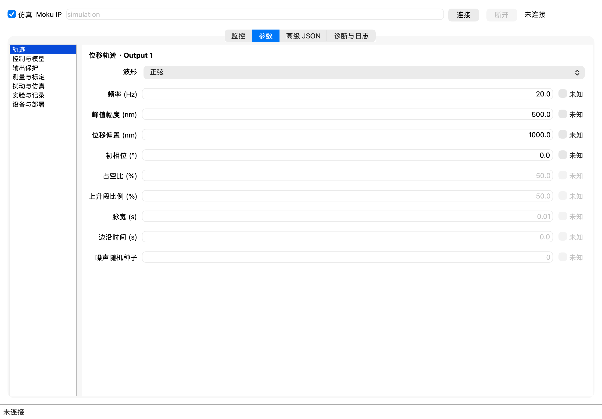
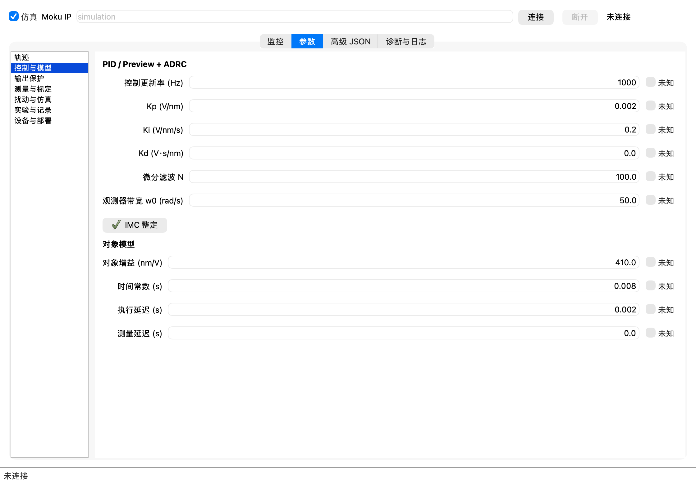
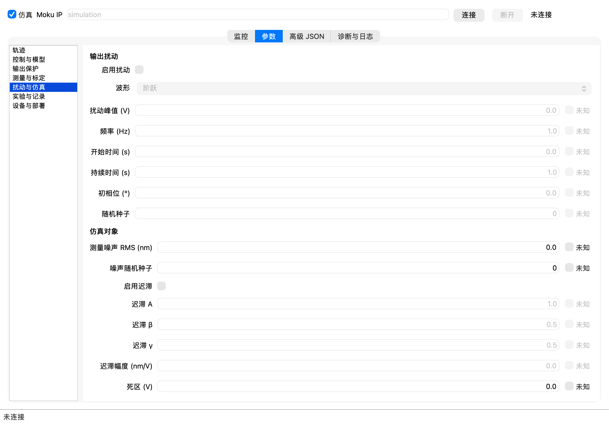
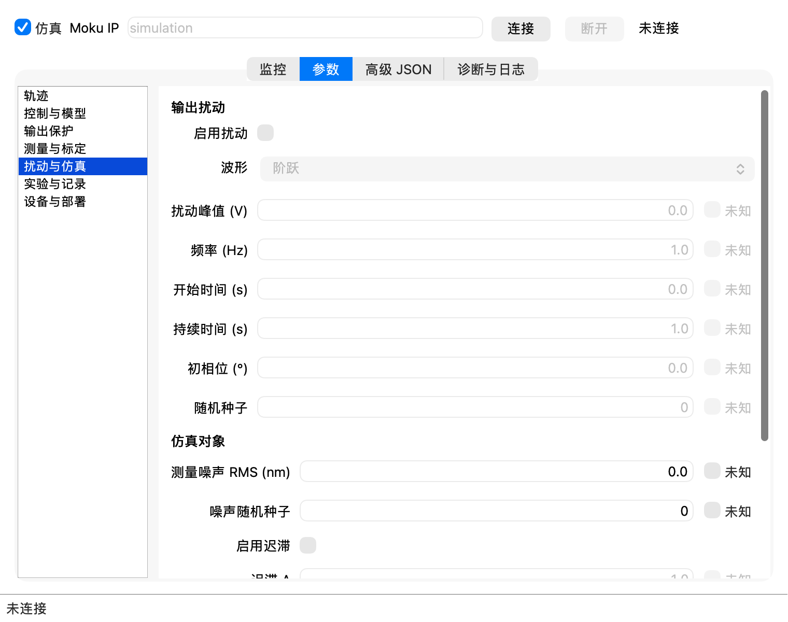
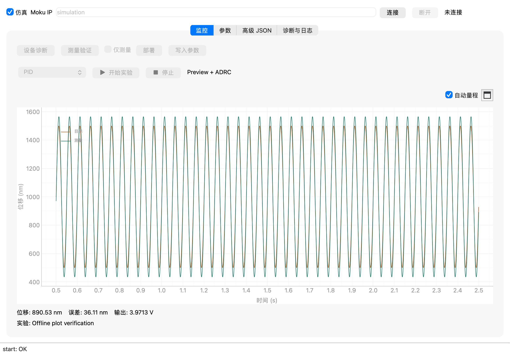

# 参数界面与运行链路验证

日期：2026-10-23。环境：macOS arm64，Python 3.13.13。

## 界面

新增“参数”页，分为轨迹、控制与模型、输出保护、测量与标定、扰动与仿真、实验与记录、设备与部署。
核对了原版 `closed_loop.py` 与 `moku_waveform.py`，恢复适用于单轴板上控制的设置。
提供 PID 系数、微分滤波、观测器带宽、IMC 整定、对象增益/时间常数/延迟、位移波形和输出保护等表单。
记录目录由本机设置保存；实验始终保存 CSV、配置快照和结果，避免关闭记录后误报验收指标。
旧版独立波形平滑 PID、第二轴和未验证的实机自动辨识没有作为可用功能加入。

普通窗口 1120×780、紧凑窗口 760×600 均使用原生 Qt 截图检查。长页面可滚动，未见字段或导航重叠。

## 参数确实生效

真实 Qt 界面到本项目仿真设备的集成测试使用真实后台线程和实验写入器。
连接并写入初始配置后，修改模型增益为 500 nm/V、轨迹峰值为 100 nm、偏置为 800 nm、初相位为 90°，
同时配置 +0.1 V 阶跃扰动，在 0.05 s 开始并持续 0.04 s。

验证了修改使原确认失效、重新写入才能启动、实验中参数锁定以及完成后恢复编辑。
0.18 s 开环仿真保存 180 个连续样本：第一个目标为 900 nm；0.06 s 时存在约 0.1 V 注入，
0.02 s 和 0.10 s 时注入为零。输出符合 `reference / 500 + disturbance` 的定点精度。
配置快照与设备有效模型均保存修改后的值。仿真 CSV 新增 `disturbance_v`；实机没有可验证采样时保持为空。

驱动扰动在控制器输出之后、共同限幅限速之前注入。Preview 模型使用实际施加电压，包含该注入；
因此这不是未知负载扰动，也不能单凭此测试证明 ADRC 抗未知扰动优于 PID。
测量高斯噪声、死区和 Bouc-Wen 迟滞另有仿真参数及效果测试。

## 验证结果

| 检查 | 结果 |
| --- | --- |
| `.venv/bin/python -X faulthandler -m pytest tests test_control.py -q` | 196 passed，27.12 s，退出码 0 |
| 最后界面调整后的 GUI、参数、真实仿真工作流复测 | 12 passed，4.45 s，退出码 0 |
| FPGA 协议测试 | 118 项，包含 90 次实际 Icarus RTL 运行 |
| RTL 组合 | 六种轨迹 × 五种扰动模式（含关闭）× 三种控制器 |
| 配置、设备和迁移测试 | 65 passed，包含旧配置补全、无效参数、模型更新、噪声复现及保护 |
| `.venv/bin/python -m PyInstaller --noconfirm moku_host.spec` | 成功，退出码 0 |
| 打包应用 `--simulation --diagnose` | 成功，输出有效模型和无输出阻断项，退出码 0 |
| 打包应用启动 | 成功，已打开“参数”页 |

FPGA 配置协议升级为 ABI 2（`0x4C415302`，47 个配置字），旧 bitstream 不匹配时禁止启用输出。
本机没有 Moku:Go，未运行真实 bitstream，也未验证综合资源、时序、双路测相、物理输出或性能指标。
当前测试使用本项目数值仿真及 Icarus RTL 仿真，不是官方 Moku 演示功能执行自定义控制器。
Linux 和 Windows 的实际运行及原生打包仍待相应系统验证。

## 图表量程修复

复现：将纵轴缩放到 0–10 nm 后，pyqtgraph 关闭自动量程。原实现开始新实验时只清空数据，
没有恢复量程，因此 600–900 nm 的曲线仍在视窗外。
修复后，新实验清空旧曲线并恢复双轴自动量程；新增“自动量程”开关和“适应数据”图标按钮。
手动缩放会取消自动量程，重新勾选或点击适应按钮可立即恢复，并跟随后续数据更新。

相关 GUI、参数和真实实验流程测试共 15 项通过，退出码 0；新增三项回归检查覆盖新实验复位、
找回视窗外曲线并继续跟随，以及保留手动查看范围。
真实仿真重放保存 2000 个显示点，自动纵轴范围约 373–1627 nm；截图检测到测量曲线和目标曲线颜色，
并检查了普通及紧凑窗口。macOS 应用已重建并重新打开。

## 提交前最终状态

界面控制模式已按要求仅保留 PID 与 Preview + ADRC，移除了低幅开环和自动 A/B 入口。
相关界面与实验流程复测 16 项通过；最终执行
`.venv/bin/python -X faulthandler -m pytest tests test_control.py -q`，
结果为 244 passed，28.29 s，退出码 0。
上文和截图保留各次验证时的状态；Windows 和真实硬件仍未实测。
